# Flujograma y Catálogo de Fórmulas de la Plataforma Solar

Este documento refleja fielmente la lógica de cálculo del motor solar (`cotizador2Engine.ts` / `Cotizador2.xlsx`), organizado según **los nombres exactos de los campos tal como aparecen en los módulos de la plataforma**, incluyendo **la fórmula de Excel exacta extraída directamente de cada celda del archivo original** (hoja `Cotizacion` y hoja `Bases de Datos`).

---

## 1. Diagrama de Flujo con Nombres Reales de la Plataforma

```mermaid
flowchart TD
    classDef input fill:#e0f2fe,stroke:#0284c7,stroke-width:2px,color:#0369a1;
    classDef formula fill:#fef3c7,stroke:#d97706,stroke-width:2px,color:#92400e;
    classDef output fill:#dcfce7,stroke:#16a34a,stroke-width:2px,color:#15803d;

    subgraph ModCliente ["1. DATOS DEL CLIENTE (Entradas)"]
        IN_TRM["TRM del día"]:::input
        IN_CONS["Consumo promedio (kWh/mes)"]:::input
        IN_COSTO["Costo del kWh (COP)"]:::input
        IN_CONTRIB["Contribución 20%"]:::input
        IN_TRANS["Transformador (kVA)"]:::input
        IN_AHORRO_DES["Ahorro deseado (1 = 100%)"]:::input
    end

    subgraph ModUbicacion ["2. SISTEMA Y UBICACIÓN (Entradas)"]
        IN_AREA["Área disponible (m²)"]:::input
        IN_PANEL_W["Capacidad del panel (W)"]:::input
        IN_DEPTO["Departamento"]:::input
        IN_RAD_TIPO["Radiación (Tipo: Promedio/Mínimo/Máximo)"]:::input
        IN_TURNOS["Turnos de operación"]:::input
    end

    subgraph ModFactores ["3. FACTORES INICIALES"]
        F_VALOR_KWH["Valor kWh factura<br/><b>Excel:</b> =IF(C9='Si',C8*1.2,C8)<br/><b>Lógica:</b> SI(Contribución 20% = 'Si'; Costo * 1.2; Costo)"]:::formula
        F_RAD["Radiación (HSP)<br/><b>Excel:</b> =VLOOKUP(C15,'Bases de Datos'!G5:J38,col,0)<br/><b>Lógica:</b> BUSCARV(Departamento; Bases; Radiación)"]:::formula
    end

    subgraph ModReq ["4. SISTEMA REQUERIDO POR CONSUMO"]
        F_POT_REQ["Potencia P requerida<br/><b>Excel:</b> =(C12*1000)/(C20*30)<br/><b>Lógica:</b> (Consumo * 1000) / (Radiación * 30)"]:::formula
        F_PAN_REQ["Paneles<br/><b>Excel:</b> ='Bases de Datos'!C24 -> =EVEN(C23/C15)<br/><b>Lógica:</b> REDONDEAR.PAR(Potencia P requerida / Capacidad panel)"]:::formula
        F_POT_PICO["Potencia pico ofrecida<br/><b>Excel:</b> =C24*605<br/><b>Lógica:</b> Paneles * 605"]:::formula
        F_AREA_REQ["Área requerida<br/><b>Excel:</b> ='Bases de Datos'!C26 -> =EVEN(C24*2.8)<br/><b>Lógica:</b> REDONDEAR.PAR(Paneles * 2.8)"]:::formula
        F_PROD_REQ["Producción mensual<br/><b>Excel:</b> ='Bases de Datos'!C27 -> =(C24*C15*C20*30)/1000<br/><b>Lógica:</b> (Paneles * Capacidad panel * Radiación * 30) / 1000"]:::formula
        F_WP_REQ["Wp instalados<br/><b>Excel:</b> ='Bases de Datos'!C28 -> =C24*C15<br/><b>Lógica:</b> Paneles * Capacidad panel"]:::formula
        F_KWP_REQ["kWp<br/><b>Excel:</b> =C28/1000<br/><b>Lógica:</b> Wp instalados / 1000"]:::formula
        F_AHORRO_REQ["Ahorro (%)<br/><b>Excel Cotizacion!F16:</b> ='Bases de Datos'!C30<br/><b>Excel Bases!C30:</b> =(C29*C20*30)/C12"]:::formula
    end

    subgraph ModArea ["5. SISTEMA SEGÚN ÁREA DISPONIBLE"]
        F_POT_AREA["Potencia en área kW<br/><b>Excel:</b> =((Cotizacion!C14*0.85)/2)*(Cotizacion!C17/1000)"]:::formula
        F_PAN_AREA["Paneles por área<br/><b>Excel:</b> =EVEN((C13*1000)/C15)"]:::formula
        F_AREA_REQ_A["Área requerida (área)<br/><b>Excel:</b> =EVEN(C14*2.8)"]:::formula
        F_PROD_AREA["Producción mensual (área)<br/><b>Excel:</b> =(C14*C15*C20*30)/1000"]:::formula
        F_WP_AREA["Wp instalados (área)<br/><b>Excel:</b> =C14*C15"]:::formula
        F_KWP_AREA["kWp (área)<br/><b>Excel:</b> =C18/1000"]:::formula
        F_AHORRO_AREA["Ahorro (área)<br/><b>Excel:</b> =(C19*C20*30)/C12"]:::formula
    end

    subgraph ModAmbiental ["6. GENERACIÓN E IMPACTO AMBIENTAL"]
        F_GEN_CONS["Generación mensual a consumir<br/><b>Excel:</b> =C24*C15*C20*C37"]:::formula
        F_GEN_INY["Generación mensual a inyectar<br/><b>Excel:</b> =C24*C15*C20*(30-C37)"]:::formula
        F_GEN_TOT["Generación total<br/><b>Excel:</b> =C34+C35"]:::formula
        F_CO2["Ahorro en CO₂ (ton/año)<br/><b>Excel:</b> =(((C36*12)/1000)/1000)*0.39"]:::formula
        F_ARB["Árboles<br/><b>Excel:</b> =C38*2"]:::formula
    end

    subgraph ModCotiz ["7. COTIZACIÓN & FINANCIERO"]
        F_COSTO_VATIO["Costo por vatio (COP)<br/><b>Excel:</b> =VLOOKUP(F6,'Bases de Datos'!L4:O36,2,TRUE)*C5"]:::formula
        F_COSTO_SOL["Costo de la solución<br/><b>Excel:</b> =VLOOKUP(F6,'Bases de Datos'!L4:O36,2,TRUE)*F6*C5"]:::formula
        F_AHORRO_MES["Ahorro mensual<br/><b>Excel:</b> =((Cotizacion!C10*Cotizacion!F14))"]:::formula
        F_RETORNO["Retorno (Meses / Años)<br/><b>Excel:</b> =COUNTIF(B21:KP21,'<0')"]:::formula
        F_TIR["TIR<br/><b>Excel:</b> =+IRR(B21:AA21)"]:::formula
        F_AHORRO_30["Ahorro en 30 años<br/><b>Excel:</b> =+'Modelo Financiero Año'!AF21"]:::formula
    end

    subgraph ModAndres ["⚡ METODOLOGÍA OFICIAL ANDRÉS (NASA POWER LIVE)"]
        F_ANDRES_CONS["E_consumoAnual = ConsumoMensual * 12"]:::formula
        F_ANDRES_IRR["Irradiancia = NASA POWER (kWh/m²/día)"]:::input
        F_ANDRES_PAN["NroPaneles = E_consumoAnual / (PotPanel_kWp * 365 * Irradiancia * 80%)"]:::formula
        F_ANDRES_GEN["E_genAnual = NroPaneles * PotPanel_kWp * 365 * Irradiancia * 80%"]:::output
    end

    subgraph SalidasFinales ["8. RESULTADOS CLAVE EN PLATAFORMA"]
        OUT_SYS["Sistema Instalado<br/>(Paneles, kWp, Área requerida)"]:::output
        OUT_ECO["Impacto Ambiental<br/>(CO₂ evitado, Árboles)"]:::output
        OUT_INV["Inversión Llave en Mano<br/>(Costo de la solución, Costo por vatio)"]:::output
        OUT_ROI["Retorno Económico<br/>(Ahorro mensual, Ahorro 30 años, Retorno, TIR)"]:::output
    end

    %% Conexiones
    IN_COSTO & IN_CONTRIB --> F_VALOR_KWH
    IN_DEPTO & IN_RAD_TIPO --> F_RAD

    IN_CONS & F_RAD --> F_POT_REQ
    F_POT_REQ & IN_PANEL_W --> F_PAN_REQ
    F_PAN_REQ --> F_POT_PICO
    F_PAN_REQ --> F_AREA_REQ
    F_PAN_REQ & IN_PANEL_W --> F_WP_REQ --> F_KWP_REQ
    F_PAN_REQ & IN_PANEL_W & F_RAD --> F_PROD_REQ
    F_KWP_REQ & F_RAD & IN_CONS --> F_AHORRO_REQ

    IN_AREA & IN_PANEL_W --> F_POT_AREA
    F_POT_AREA & IN_PANEL_W --> F_PAN_AREA
    F_PAN_AREA --> F_AREA_REQ_A
    F_PAN_AREA & IN_PANEL_W & F_RAD --> F_PROD_AREA
    F_PAN_AREA & IN_PANEL_W --> F_WP_AREA --> F_KWP_AREA
    F_KWP_AREA & F_RAD & IN_CONS --> F_AHORRO_AREA

    F_PAN_REQ & IN_PANEL_W & F_RAD & IN_TURNOS --> F_GEN_CONS
    F_PAN_REQ & IN_PANEL_W & F_RAD & IN_TURNOS --> F_GEN_INY
    F_GEN_CONS & F_GEN_INY --> F_GEN_TOT
    F_GEN_TOT --> F_CO2 --> F_ARB

    F_WP_REQ & IN_TRM --> F_COSTO_VATIO
    F_COSTO_VATIO & F_WP_REQ --> F_COSTO_SOL
    F_PROD_REQ & F_VALOR_KWH --> F_AHORRO_MES
    F_COSTO_SOL & F_AHORRO_MES --> F_RETORNO
    F_COSTO_SOL & F_AHORRO_MES --> F_TIR
    F_AHORRO_MES --> F_AHORRO_30

    %% Conexiones Metodología Andrés (NASA POWER)
    IN_CONS --> F_ANDRES_CONS
    F_ANDRES_CONS & IN_PANEL_W & F_ANDRES_IRR --> F_ANDRES_PAN
    F_ANDRES_PAN & IN_PANEL_W & F_ANDRES_IRR --> F_ANDRES_GEN
    F_ANDRES_PAN & F_ANDRES_GEN -.-> OUT_SYS

    F_PAN_REQ & F_KWP_REQ & F_AREA_REQ --> OUT_SYS
    F_CO2 & F_ARB --> OUT_ECO
    F_COSTO_VATIO & F_COSTO_SOL --> OUT_INV
    F_AHORRO_MES & F_AHORRO_30 & F_RETORNO & F_TIR --> OUT_ROI
```

---

## 2. Metodología Oficial Andrés: Dimensionamiento e Integración NASA POWER

Especificación matemática directa del documento `formula andres.docx`, implementada al 100% en el motor en vivo `solarCalculator.ts` y visualizada en el componente **Reflejo en Vivo del Proyecto**:

1. **Consumo Anual:**
   $$E_{\text{consumoAnual}} = \text{ConsumoMensual(Factura)} \times 12$$
2. **Irradiancia:**
   $$\text{Irradiancia} = \text{Radiación Solar Horizontal (NASA POWER API) en } \text{kWh/m}^2/\text{day}$$
3. **Número de Paneles:**
   $$\text{NroPaneles} = \frac{E_{\text{consumoAnual}}}{\text{PotPanel(kWp)} \times 365\text{días} \times \text{irradiancia} \times \text{eficiencia}(80\%)}$$
4. **Generación Anual:**
   $$E_{\text{genAnual}} = \text{NroPaneles} \times \text{PotPanel(kWp)} \times 365\text{días} \times \text{irradiancia} \times \text{eficiencia}(80\%)$$

| Variable | Código en Plataforma | Fuente / Celda | Valor Ejemplo | Lógica de Cálculo |
| :--- | :--- | :--- | :--- | :--- |
| **E_consumoAnual** | `res.annualConsumptionKwh` | `formula andres.docx` | `4.800 kWh/año` | `ConsumoMensual * 12` |
| **Irradiancia (NASA)** | `res.effectiveHspUsed` | `NASA POWER API` | `5.51 HSP` | Horas de Sol Pico horizontales promedio diario |
| **eficiencia (80%)** | `QUOTE_PARAMS.systemEfficiency` | `Cotizacion!G9` | `80% (0.80)` | Factor de rendimiento que descuenta 20% en pérdidas térmicas y eléctricas |
| **365dias** | `QUOTE_PARAMS.daysPerYear` | Constante | `365 días` | Anualización astronómica |
| **PotPanel(kWp)** | `inputs.panelWattage / 1000` | Catálogo / `Cotizacion!C15` | `0.58 kWp` | Potencia unitaria de cada panel en kilovatios pico |
| **NroPaneles** | `res.panelCount` (`Math.ceil`) | `formula andres.docx` | `6 paneles (5.14)` | `E_consumoAnual / (PotPanel * 365 * Irrad * 0.8)` |
| **Potencia Pico** | `res.actualInstalledKwp` | `Cotizacion!C5` | `3.48 kWp` | `NroPaneles * PotPanel(kWp)` (ej. 6 × 0.58 kWp = 3.48 kWp) |
| **E_genAnual** | `res.annualGenerationKwh` | `formula andres.docx` | `5.600 kWh/año` | `NroPaneles * PotPanel * 365 * Irradiancia * 0.8` (467 kWh/mes) |

---

## 3. Catálogo de Fórmulas de Excel y Variables por Módulo (Cotizador2)

### 1. DATOS DEL CLIENTE (Entradas)
| Nombre en Plataforma (Imagen) | Variable Código | Celda Excel | Valor Ejemplo | Celda y Fórmula en Excel | Lógica con Nombres de Plataforma |
| :--- | :--- | :--- | :--- | :--- | :--- |
| **TRM del día** | `inp.trm` | `Cotizacion!C5` | `3.900` | Valor directo: `3900` | Se usa en `Cotizacion!F19` multiplicando por la escala de precios USD |
| **Consumo promedio (kWh/mes)** | `inp.consumoKwh` | `Cotizacion!C7` | `400` | Valor directo: `400` | Enlazado en `'Bases de Datos'!C12 = Cotizacion!C7` |
| **Costo del kWh (COP)** | `inp.costoKwhBase` | `Cotizacion!C8` | `790,49` | Valor directo: `790.49` | Se procesa en `Cotizacion!C10 = IF(C9="Si", C8*1.2, C8)` |
| **Contribución 20%** | `inp.contribucion20` | `Cotizacion!C9` | `Si` | Valor directo: `"Si"` | Si es "Si", aplica el factor 1,2 en `Cotizacion!C10` |
| **Transformador (kVA)** | `inp.transformador` | `Cotizacion!C11` | `75` | Valor directo: `75` | Enlazado en `'Bases de Datos'!C31 = Cotizacion!C11` |
| **Ahorro deseado (1 = 100%)** | `inp.ahorroDeseado` | `Cotizacion!C12` | `1` | Valor directo: `1` | Enlazado en `'Bases de Datos'!C32 = Cotizacion!C12` |

---

### 2. SISTEMA Y UBICACIÓN (Entradas)
| Nombre en Plataforma (Imagen) | Variable Código | Celda Excel | Valor Ejemplo | Celda y Fórmula en Excel | Lógica con Nombres de Plataforma |
| :--- | :--- | :--- | :--- | :--- | :--- |
| **Área disponible (m²)** | `inp.areaDisponible` | `Cotizacion!C14` | `54` | Valor directo: `54` | Se usa en `'Bases de Datos'!C13` para calcular kW en techo |
| **Capacidad del panel (W)** | `inp.potenciaPanel` | `Cotizacion!C17` | `620 W` | Valor directo: `620` | Enlazado en `'Bases de Datos'!C15 = +Cotizacion!C17` |
| **Departamento** | `inp.departamento` | `Cotizacion!C15` | `Antioquia` | Valor directo: `"Antioquia"` | Clave de búsqueda de radiación en `Cotizacion!F12` |
| **Radiación** | `inp.radiacionTipo` | `Cotizacion!C16` | `Minimo` | Valor directo: `"Minimo"` | Condición en `Cotizacion!F12` para elegir columna (Prom/Mín/Máx) |
| **Turnos de operación** | `inp.turnosOperacion` | `Bases de Datos!C37` | `2` | Valor directo: `2` | Pondera autoconsumo en `'Bases de Datos'!C34` |

---

### 3. MODELO FINANCIERO (Entradas y Parámetros)
| Nombre en Plataforma (Imagen) | Variable Código | Celda Excel | Valor Ejemplo | Celda y Fórmula en Excel | Lógica con Nombres de Plataforma |
| :--- | :--- | :--- | :--- | :--- | :--- |
| **Beneficio tributario** | `inp.beneficioTributario` | `Modelo Financiero Año!E1` | `Si` | Valor directo: `"Si"` | Habilita filas 16-18 (Ley 1715) en Modelo Financiero |
| **Mantenimiento gratis (año 1)** | `inp.mantenimientoGratis` | `Modelo Financiero Año!E3` | `Si` | Valor directo: `"Si"` | En fila 15 año 1: `=IF(E3="si", 0, -B5)` |
| **Financiación** | `inp.financiacion` | `Modelo Financiero Año!E2` | `No` | Valor directo: `"No"` | Define si el desembolso inicial se descuenta con crédito |

---

### 4. SISTEMA SEGÚN ÁREA DISPONIBLE (Cálculos de Capacidad Máxima)
| Nombre en Plataforma (Imagen) | Variable Código | Celda Excel | Valor Ejemplo | Fórmula de Excel Exacta | Lógica con Nombres de Plataforma |
| :--- | :--- | :--- | :--- | :--- | :--- |
| **Valor kWh factura** | `r.valorKwhFactura` | `Cotizacion!C10` | `948,588` | `=IF(C9="Si",C8*1.2,C8)` | `SI(Contribución 20% = "Si"; Costo * 1.2; Costo)` |
| **Consumo kWh/mes** | `inp.consumoKwh` | `Bases de Datos!C12` | `400` | `=Cotizacion!C7` | `= Consumo promedio (kWh/mes)` |
| **Potencia en área kW** | `r.potenciaEnAreaKw` | `Bases de Datos!C13` | `14,23` | `=((Cotizacion!C14*0.85)/2)*(Cotizacion!C17/1000)` | `((Área * 0.85) / 2) * (Capacidad panel / 1000)` |
| **Paneles por área** | `r.porArea.paneles` | `Bases de Datos!C14` | `24` | `=EVEN((C13*1000)/C15)` | `REDONDEAR.PAR((Potencia área * 1000) / Capacidad panel)` |
| **Potencia panel** | `inp.potenciaPanel` | `Bases de Datos!C15` | `620 W` | `=+Cotizacion!C17` | `= Capacidad del panel (W)` |
| **Área requerida** | `r.porArea.areaRequerida` | `Bases de Datos!C16` | `68 m²` | `=EVEN(C14*2.8)` | `REDONDEAR.PAR(Paneles por área * 2.8)` |
| **Producción mensual** | `r.porArea.produccionMensual` | `Bases de Datos!C17` | `1.754 kWh` | `=(C14*C15*C20*30)/1000` | `(Paneles * Capacidad panel * Radiación * 30) / 1000` |
| **Wp instalados** | `r.porArea.wpInstalados` | `Bases de Datos!C18` | `14.880` | `=C14*C15` | `Paneles por área * Capacidad panel` |
| **kWp** | `r.porArea.kwp` | `Bases de Datos!C19` | `14,88` | `=C18/1000` | `Wp instalados / 1000` |
| **Radiación** | `r.radiacion` | `Cotizacion!F12` | `3,93` | `=IF(C16='Bases de Datos'!H5,VLOOKUP(C15,'Bases de Datos'!G5:J38,2,0),IF(C16='Bases de Datos'!I5,VLOOKUP(C15,'Bases de Datos'!G5:J38,3,0),IF(C16='Bases de Datos'!J5,VLOOKUP(C15,'Bases de Datos'!G5:J38,4,0))))` | `BUSCARV(Departamento; Bases!G5:J38; ColumnaSegunTipo; 0)` |
| **Ahorro** | `r.porArea.ahorro` | `Bases de Datos!C21` | `438,59%` | `=(C19*C20*30)/C12` | `(kWp * Radiación * 30) / Consumo kWh/mes` |

---

### 5. SISTEMA REQUERIDO POR CONSUMO (Dimensionamiento Recomendado)
| Nombre en Plataforma (Imagen) | Variable Código | Celda Excel | Valor Ejemplo | Fórmula de Excel Exacta | Lógica con Nombres de Plataforma |
| :--- | :--- | :--- | :--- | :--- | :--- |
| **Potencia P requerida** | `r.requerido.potenciaRequeridaW` | `Bases de Datos!C23` | `3.393` | `=(C12*1000)/(C20*30)` | `(Consumo * 1000) / (Radiación * 30)` |
| **Paneles** | `r.requerido.paneles` | `Cotizacion!F8` &rarr; `Bases!C24` | `6` | `Cotizacion!F8: ='Bases de Datos'!C24` `Bases!C24: =EVEN(C23/C15)` | `REDONDEAR.PAR(Potencia P requerida / Capacidad panel)` |
| **Potencia pico ofrecida** | `r.requerido.potenciaPicoOfrecida` | `Bases de Datos!C25` | `3.630` | `=C24*605` | `Paneles * 605` |
| **Área requerida** | `r.requerido.areaRequerida` | `Cotizacion!F10` &rarr; `Bases!C26` | `18 m²` | `Cotizacion!F10: ='Bases de Datos'!C26` `Bases!C26: =EVEN(C24*2.8)` | `REDONDEAR.PAR(Paneles * 2.8)` |
| **Producción mensual** | `r.requerido.produccionMensual` | `Cotizacion!F14` &rarr; `Bases!C27` | `439 kWh` | `Cotizacion!F14: ='Bases de Datos'!C27` `Bases!C27: =(C24*C15*C20*30)/1000` | `(Paneles * Capacidad panel * Radiación * 30) / 1000` |
| **Wp instalados** | `r.requerido.wpInstalados` | `Cotizacion!F6` &rarr; `Bases!C28` | `3.720` | `Cotizacion!F6: ='Bases de Datos'!C28` `Bases!C28: =C24*C15` | `Paneles * Capacidad panel` |
| **kWp** | `r.requerido.kwp` | `Bases de Datos!C29` | `3,72` | `=C28/1000` | `Wp instalados / 1000` |
| **Ahorro** | `r.requerido.ahorro` | `Cotizacion!F16` &rarr; `Bases!C30` | `109,65%` | `Cotizacion!F16: ='Bases de Datos'!C30` `Bases!C30: =(C29*C20*30)/C12` | `(kWp * Radiación * 30) / Consumo promedio` |
| **Transformador** | `r.transformador` | `Bases de Datos!C31` | `75` | `=Cotizacion!C11` | `= Transformador (kVA)` |
| **Ahorro deseado** | `r.ahorroDeseado` | `Bases de Datos!C32` | `100,00%` | `=Cotizacion!C12` | `= Ahorro deseado (1 = 100%)` |

---

### 6. GENERACIÓN E IMPACTO AMBIENTAL (Balance Energético y Ecológico)
| Nombre en Plataforma (Imagen) | Variable Código | Celda Excel | Valor Ejemplo | Fórmula de Excel Exacta | Lógica con Nombres de Plataforma |
| :--- | :--- | :--- | :--- | :--- | :--- |
| **Generación mensual a consumir** | `r.generacionMensualConsumir` | `Bases de Datos!C34` | `29.239` | `=C24*C15*C20*C37` | `Paneles * Capacidad panel * Radiación * Turnos` |
| **Generación mensual a inyectar** | `r.generacionMensualInyectar` | `Bases de Datos!C35` | `409.349` | `=C24*C15*C20*(30-C37)` | `Paneles * Capacidad panel * Radiación * (30 - Turnos)` |
| **Generación total** | `r.generacionTotal` | `Bases de Datos!C36` | `438.588` | `=C34+C35` | `Gen. Consumir + Gen. Inyectar` |
| **Turnos de operación** | `r.turnosOperacion` | `Bases de Datos!C37` | `2` | Valor directo: `2` | Turnos de trabajo activos |
| **Ahorro en CO₂ (ton/año)** | `r.ahorroCo2` | `Cotizacion!F22` &rarr; `Bases!C38` | `2,05` | `Cotizacion!F22: ='Bases de Datos'!C38` `Bases!C38: =(((C36*12)/1000)/1000)*0.39` | `(((GenTotal * 12) / 1000) / 1000) * 0.39` |
| **Árboles** | `r.arboles` | `Cotizacion!F24` &rarr; `Bases!C39` | `4,11` | `Cotizacion!F24: ='Bases de Datos'!C39` `Bases!C39: =C38*2` | `Ahorro en CO₂ (ton/año) * 2` |

---

### 7. COTIZACIÓN (Inversión y Retorno Financiero)
| Nombre en Plataforma (Imagen) | Variable Código | Celda Excel | Valor Ejemplo | Fórmula de Excel Exacta | Lógica con Nombres de Plataforma |
| :--- | :--- | :--- | :--- | :--- | :--- |
| **Costo por vatio (COP)** | `r.costoVatio * inp.trm` | `Bases!L4:O36` | `$ 7.800 COP` | `=VLOOKUP(F6,'Bases de Datos'!L4:O36,2,TRUE)*C5` | `BUSCARV(Wp instalados; Bases!L4:O36; 2; VERDADERO) * TRM` |
| **Costo de la solución** | `r.costoSolucion` | `Cotizacion!F19` | `$ 29.016.000 COP` | `=VLOOKUP(F6,'Bases de Datos'!L4:O36,2,TRUE)*F6*C5` | `Costo por vatio (USD) * Wp instalados * TRM` |
| **Ahorro mensual** | `r.ahorroMensualCop` | `Modelo Financiero Año!B6` | `$ 416.039 COP` | `=((Cotizacion!C10*Cotizacion!F14))` | `Valor kWh factura * Producción mensual` |
| **Ahorro en 30 años** | `r.ahorro30Anios` | `Cotizacion!F26` | `$ 296.642.273 COP` | `=+'Modelo Financiero Año'!AF21` | `Flujo neto acumulado en el año 30` |
| **Retorno** | `r.retornoMeses / r.retornoAnios` | `Cotizacion!F28` | `42 meses (4 años)` | `='Modelo Financiero Mes'!E7` `=COUNTIF(B21:KP21,"<0")` | `CONTAR.SI(Flujo acumulado < 0) [Meses y Años]` |
| **TIR** | `r.tir` | `Cotizacion!F30` | `27,22%` | `=+IRR(B21:AA21)` | `TIR(Flujos acumulados del año 0 al 25)` |
